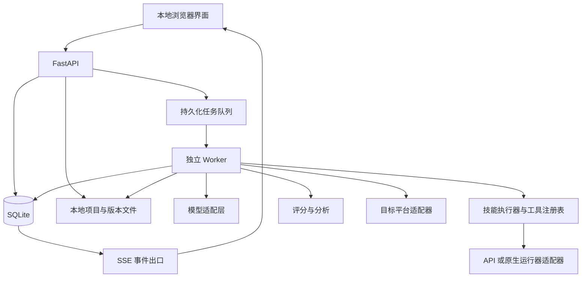

# 个人版技能生产与评测工作台：完整设计与使用细节

版本：1.0  
日期：2026-10-02  
状态：设计文档，尚未实现或实测  
对象：个人自用，运行在自己的电脑上

## 1. 设计依据与范围

本方案依据用户提供的《skill-creator详细介绍.md》及后续要求整理。原文作为流程参考，其中的命名限制、安装目录、打包格式等属于待目标平台验证的规则，不作为跨平台事实或自动执行指令。

用户已明确：产品用于个人；不能因为个人使用而缩减功能；需要保留技能创建、执行、评测、分析、优化和分发的完整能力。

设计目标是：用户描述需求，系统生成技能，通过可复现的对照评测和人工反馈改进，验证触发描述，最后导出或安装。任何跳过步骤都由用户主动选择，界面应明确显示哪些环节未验证。

部署简化与功能缩减必须分开。去掉多人账号、组织权限、计费、分布式集群；保留多模型、并行评测、盲评、描述优化、版本管理、报告导出、任务恢复和安装能力。

不承诺模型自动判断一定正确。质量结论必须绑定证据、测试范围和执行环境。

## 2. 完整功能清单

| 环节 | 必须支持的功能 | 使用细节 |
|---|---|---|
| 需求捕获 | 对话、文档导入；结构化访谈；输入输出与触发条件提取 | 显示明确要求、推断和待确认项 |
| 初稿生成 | SKILL.md、scripts、references、assets；文件编辑与校验 | 按需生成资源，不为凑结构生成空文件 |
| 测试设计 | 真实提示词、附件、断言、评分量表、人工确认 | 自动生成的测试不能默认等同于完整覆盖 |
| 对照执行 | 无技能基线、旧版本基线、并行运行、重复运行 | 每组使用独立上下文和工作目录 |
| 评分 | 程序校验、模型评分、人工评分 | 区分客观断言和主观判断 |
| 报告 | 逐例结果、反馈、基准统计、异常分析、离线 HTML | 输出证据与统计口径同时展示 |
| 盲评 | 匿名 A/B、顺序随机化、独立评审、证据记录 | 平局与不可判断必须允许 |
| 改进 | 通用问题归纳、修改建议、脚本提取、差异、回退 | 修改产生新版本，不覆盖旧版本 |
| 描述优化 | 正负样例、优化与验证分离、多轮候选、触发统计 | 实际运行环境和模拟环境分别标记 |
| 分发 | 校验、完整打包、导出、安装、备份与恢复 | 各平台通过适配器确定规则 |
| 运行管理 | 取消、重试、恢复、预算、并发、模型配置 | 页面关闭不终止 Worker |

## 3. 技术栈与选择理由

| 层 | 推荐技术 | 职责 |
|---|---|---|
| 前端 | React、TypeScript、Vite | 聊天访谈、文件编辑、差异、对照、图表与任务交互 |
| API | FastAPI、Pydantic | 请求校验、业务接口、模型与平台适配 |
| 状态存储 | SQLite | 项目、版本、任务、评分、反馈、配置索引 |
| 文件存储 | 本地文件系统 | 附件、版本文件、执行产物、报告和归档 |
| 执行 | 独立 Python Worker 进程 | 领取任务、执行阶段、写入结果、处理取消 |
| 实时事件 | SSE | 推送状态和日志；支持断线后补取事件 |
| 模型 | 提供商官方 SDK + 统一适配层 | 按角色选择模型、结构化输出、工具调用、用量记录 |
| 打包 | Python zipfile + 平台适配器 | 生成可复现归档并验证解压结构 |
| 验证 | pytest、前端组件测试、必要的浏览器端到端测试 | 校验核心逻辑与完整用户流程 |

最终版本采用本地 Web 应用。Streamlit 可用于临时验证，但不作为最终首选，因为产品需要较复杂的文件编辑、差异和评审交互。

个人版无需 PostgreSQL、Redis、Celery 或云对象存储。SQLite 持久化队列是本方案自建组件，并非 SQLite 自带工作流引擎；需要实现任务领取、租约、恢复和幂等逻辑。

依赖版本在实际实现时选择兼容的稳定版本，锁定到依赖文件。本文不指定未经验证的版本号。

## 4. 总体架构



模块边界：

- 需求模块产出结构化需求，不执行附件里的命令。
- 生成模块产出文件清单与内容，由程序校验和落盘。
- 执行模块加载技能、运行工具、记录轨迹与产物。
- 评分模块读取结果及量表，不直接修改技能。
- 分析与改进模块提出修改并生成新版本。
- 打包安装模块处理目标平台格式和安装路径。
- 状态机与任务队列决定阶段推进，模型不直接控制任意状态跳转。

## 5. 页面与实际使用路径

### 5.1 首页与项目

首页显示项目、最近技能版本、进行中任务、待评审结果。支持创建项目、导入已有技能、导入对话或文档、打开历史项目。删除项目需显示将删除的版本、结果和附件，并提供先导出备份的操作。

### 5.2 需求访谈

用户输入“我想把某流程做成技能”，或导入成熟流程。系统提取：用途、触发与不触发条件、输入、输出、工具依赖、成功标准、示例、目标平台、是否评测。

界面分列展示“用户已明确”“系统推断”“待确认”。仅追问影响实现的缺失项，用户能直接编辑需求摘要。需求修订保留历史，避免后续改进丢失约束。

### 5.3 技能编辑

左侧文件树，中间编辑器，右侧校验与解释。支持预览 Markdown、查看资源引用、编辑文件、新增资源、比较两个版本。自动保存只保存工作草稿；创建不可变版本必须有明确动作。

生成脚本展示用途、依赖、输入输出和计划运行命令。生成完成不自动执行。

### 5.4 测试与执行配置

用户可接受、编辑、增加或删除用例。每个用例显示附件、断言、量表及分类。运行前选择候选版、基线、模型、执行器、工具权限、重复次数、并发和预算。

页面展示计划运行数量与预计调用范围；工具循环可能增加实际调用次数，因此估计不能显示为确定费用。

### 5.5 对照评审

逐例左右展示输出与产物；支持全文、差异、轨迹和评分证据。用户可留下反馈，关联到用例、版本、文件或断言。基准页显示通过率、耗时、token、失败率和候选对基线的差值。

盲评模式隐藏版本映射和容易泄露身份的元信息，但不改变被评内容；报告记录匿名化规则。评审完成后可揭晓对应版本。

### 5.6 改进与发布

系统先展示问题归纳和建议修改，再生成新版本。用户可接受部分修改，继续评测或回退。发布页展示结构校验、行为评测、触发验证三类状态；未执行的检查标为“未验证”，不得显示全通过。

导出不必强制要求所有主观评测通过；用户可主动导出带明确验证状态的草稿。安装前展示目标平台、路径、文件列表及冲突处理。

## 6. 核心流程实现

### 6.1 需求结构化

建议字段：purpose、trigger_conditions、non_trigger_conditions、inputs、outputs、tools、constraints、success_criteria、examples、target_platform、evaluation_preference。

每条关键需求保存来源及来源类型：用户消息、附件原文、用户确认、系统推断。附件中的指令只作为被分析内容；若用户明确要求将其转成技能，再转换为候选工作指令。

模型返回结构化对象后执行字段与业务校验。缺失必要字段则追问；拒绝、截断、无效 JSON 和语义冲突分别处理，不无限重试。

### 6.2 文件生成与渐进式加载

生成接口返回文件清单，每项包含相对路径、内容、用途、资源类型。落盘前检查路径穿越、重复路径、编码、允许类型、体积和引用有效性。

技能选择阶段仅提供元数据；选中后加载正文；资源通过工具按需读取。必须记录实际加载了哪些文件，避免评测时把全部参考资料预塞上下文而高估平台效果。

名称格式、长度、description 限制、正文建议长度都归属平台规则。建议与硬限制分开显示，不能把原文中的“建议 500 行以内”当成通用禁止规则。

### 6.3 技能执行器

完整执行器需要支持工具循环、资源读取、脚本执行、文件产物和终止条件，不只拼接提示词。

执行模式：

1. API 执行器：自行实现技能发现、加载、工具调用和产物管理。
2. 原生运行器：通过目标工具允许的接口或 CLI 执行，用于验证真实环境。

两者不得混合标成相同环境。原生平台未提供可用自动化接口时，允许人工导入运行结果，报告记录来源和无法自动验证的部分。

每次运行使用独立目录；工具注册表声明参数 Schema、权限、超时和返回结构。设置最大轮数、总时长、单工具超时及 token 上限。支持完成、取消、预算耗尽、工具失败和模型失败等退出原因。

### 6.4 对照配置

新建技能的基线为不加载该技能；改进技能的基线为选定旧版本。两组保持相同任务、附件、模型参数、工具、预算、公共系统指令及执行环境，仅改变技能条件。

不得复用候选输出到基线。执行顺序可随机化或交错，降低时段影响。重复运行记录逐次结果；即使平台支持 seed，也不能据此保证完全确定。

多模型比较与同模型技能对照分成两个实验维度，避免把模型变化误归因于技能变化。

### 6.5 评分与异常分析

程序断言用于文件存在、结构、字段、数值与确定性结果。模型量表用于完整性、风格、解释质量等主观维度；必须输出评分依据与证据位置。人工评分可覆盖自动结论，但保留原始评分和覆盖原因。

分别记录任务不合格、执行基础设施失败、评分器失败、取消、预算耗尽。报告同时给出“计划运行数”“完成数”“可评分数”，不得静默删除失败结果来提高通过率。

分析关注：两组都通过的无区分度断言、失败集中场景、重复运行波动、成本换质量、评分与人工判断分歧。初始 2–3 用例只定位为冒烟验证。

### 6.6 盲评

每组创建随机 A/B 映射，映射不进入评分模型上下文。评分调用使用独立上下文，可配置与生成模型不同的评审模型。允许平局、不可判断和证据不足。

随机交换顺序，必要时进行顺序反转复评并记录一致性。不同模型不天然等于无偏评审；盲评结论仍需结合客观断言和人工反馈。

### 6.7 改进

输入包括固定需求、版本内容、失败证据、人工反馈、成本变化。输出包括问题类别、通用修改理由、受影响文件、预期收益、潜在回归。

修改先校验，再生成新版本。共用机械步骤可提取到 scripts；提取后要检查参数、依赖和测试覆盖。保留验证集，不将验证答案作为迭代提示词输入。配置最大轮数、预算和收益停滞条件。

### 6.8 触发描述优化

测试集包含应触发和不应触发请求；不应触发样例应包含关键词相近但任务不同的情况。约 20 条是启动规模，不是可靠性保证。

优化集用于候选生成和选择；独立验证集用于最终报告。实际技能选择环境需要包括相关竞争技能，固定目录快照，记录选中的技能 ID；支持多技能选择时单独定义命中规则。

指标：precision = TP/(TP+FP)，recall = TP/(TP+FN)，误触发率 = FP/(FP+TN)，漏触发率 = FN/(TP+FN)。分母为零时显示不可计算，不能当作 100%。

默认可设置 3–5 轮，用户可调整。最优候选选择策略可配置为兼顾误触发与漏触发，不能仅追求总准确率。写回 description 时创建新版本，并重新校验结构；行为回归需要执行后才可标记通过。

### 6.9 打包与安装

平台适配器负责元数据规范、目录结构、打包后缀、安装位置与冲突规则。原文的 .skill ZIP 约定和 .catpaw 目录仅适用于经验证兼容的目标。

包默认包含运行所需技能文件，不包含密钥、运行日志、私人测试输入。评测报告另行导出，或由用户主动选入。

打包后重新解压到临时目录，验证结构、内容哈希与引用；拒绝路径穿越、非预期符号链接及超量解压。

安装流程：解析目标 → 展示文件与冲突 → 备份已有版本 → 临时目录校验 → 替换 → 验证安装内容 → 保存安装记录。失败则恢复备份。同文件系统内优先使用原子重命名；跨文件系统走复制校验流程。

## 7. 数据模型

| 表 | 关键内容 |
|---|---|
| projects | 名称、需求、目标平台、创建时间 |
| brief_revisions | 需求版本、来源、用户确认记录 |
| skill_versions | 父版本、内容哈希、文件清单、状态 |
| eval_suites / eval_cases | 测试集版本、输入、附件、断言、量表、数据划分 |
| eval_runs | 候选与基线、执行器、配置、预算、重复次数 |
| run_results | 单次输出、轨迹、产物索引、用量、耗时、退出原因 |
| scores | 规则版本、评分来源、证据、结论 |
| reviews | 人工反馈、关联对象、覆盖原因 |
| jobs / job_attempts | 状态、租约、心跳、重试、幂等键 |
| workflow_events | 单调事件 ID、阶段、日志摘要 |
| trigger_experiments | 描述候选、目录快照、集合划分、选择结果 |
| exports / installations | 路径、哈希、平台、备份与验证状态 |
| model_configs | 提供商、模型标识、参数、凭据引用 |

不可变版本绑定不可变文件快照。API key 只保存到系统凭据存储，数据库存引用；不能写进导出包或日志。

## 8. 目录结构

```text
skill-workbench/
├── frontend/
├── backend/
│   ├── api/
│   ├── core/
│   ├── worker/
│   ├── models/
│   └── adapters/
├── tests/
└── data/
    ├── workbench.db
    ├── config/
    └── projects/<project-id>/
        ├── attachments/
        ├── briefs/
        ├── drafts/
        ├── versions/<version-id>/
        │   ├── SKILL.md
        │   ├── scripts/
        │   ├── references/
        │   └── assets/
        ├── evals/
        ├── runs/<run-id>/<case-id>/<arm>/<repeat>/
        ├── reports/
        ├── exports/
        └── backups/
```

内部 ID 与可编辑名称分开，避免重命名破坏引用。数据目录可配置，源码更新不能覆盖用户数据。

## 9. 任务状态、恢复与一致性

工作流阶段包含需求、生成、草稿评审、测试评审、执行、结果评审、改进、触发优化、导出。任务状态包含 queued、running、waiting_user、succeeded、failed、cancelled、interrupted。

人工等待属于业务状态；Worker 释放执行资源。每个评测用例、组别和重复次数对应独立子任务。

队列领取使用短数据库事务和条件更新；设置租约与心跳，过期任务标记中断。SQLite 启用适当的 WAL、忙等待和外键策略；写入事务保持短小，不在事务内等待模型响应。

幂等键绑定任务类型、版本、用例、配置与重复编号。任务采用可能重复执行的语义，结果提交去重；不承诺模型调用恰好一次。请求已发送但响应丢失时记录 unknown 状态，由策略或用户决定重试，避免隐藏潜在重复费用。

文件先写临时位置，校验后重命名，再提交索引。数据库与文件系统不是一个原子事务，需要启动时一致性检查：识别孤立文件、缺失产物和未完成提交，恢复或隔离处理。

取消通过请求标记和进程终止协作实现。只取消界面订阅不能算取消任务；上游 API 已产生费用不能保证撤回。

## 10. API 与事件契约

```text
POST /projects
POST /projects/{id}/attachments
POST /projects/{id}/brief-revisions
POST /projects/{id}/drafts
POST /projects/{id}/versions
GET  /versions/{id}/diff?base={version_id}
POST /projects/{id}/eval-suites
POST /projects/{id}/eval-runs
GET  /eval-runs/{id}/results
POST /eval-runs/{id}/reviews
POST /versions/{id}/revisions
POST /versions/{id}/trigger-experiments
POST /versions/{id}/exports
POST /exports/{id}/installations
POST /jobs/{id}/cancel
POST /jobs/{id}/retry
GET  /jobs/{id}/events
```

异步请求返回 job_id 和状态，不等待全流程完成。创建类请求支持幂等键。SSE 事件包含 event_id、job_id、stage、timestamp、progress、message；支持基于事件 ID 补取。进度使用已完成用例数，不伪造未知模型步骤的精确百分比。

## 11. 模型配置与费用

分别配置需求提取、生成、执行、评分、分析、触发优化模型，也允许全部共用同一模型。适配层声明结构化输出、工具调用、流式输出和用量统计能力；不支持的能力显式说明，不静默模拟成原生能力。

保存模型标识、提供商、参数、提示词模板版本和工具定义版本。密钥走系统凭据存储，日志脱敏。

预算控制包含最大输出 token、工具轮数、用例数量、重复次数、并发、改进轮数与项目预算。价格表标注来源和更新时间；用量缺失时显示未知，不显示零。取消及响应丢失可能导致最终费用晚于任务状态更新。

## 12. 统计与报告规范

报告必须展示实验版本、模型配置、环境、样本量、重复次数、评分规则及时间。质量、成本、错误分别统计。

每例每次结果保留原始数据。均值和标准差注明统计单位；单次观察不计算样本标准差。候选与基线差值优先采用同题配对比较，重复样本不能无说明地当成相互独立样本。

小样本不宣称统计显著或稳定提升；需要置信区间时写明方法与适用条件。通过率显示分母，执行失败不得被静默移除。

离线 HTML 自包含，不依赖在线 CDN；含逐例评审、基准页、异常分析和验证状态。网页不能承诺直接写回应用数据库：反馈通过下载 JSON 再导入，或在本地应用内评审自动保存。匿名报告应检查版本信息泄漏。

## 13. 本地运行与边界

一键启动器启动 API 与 Worker，加载本地构建好的前端，打开浏览器。默认绑定回环地址；不自动开放局域网。防止网页跨站调用本地服务，限制来源并使用本地会话凭据。

本地运行并不等于数据不离开电脑：使用远程模型时会发送选定任务内容。界面显示本次发送范围；如配置本地模型适配器，则另行验证工具调用与评测兼容性。

只运行用户选择的脚本。隔离工作目录只是文件组织方式，不是安全沙箱；限制 cwd 和超时不能阻止任意脚本访问其他文件。提供可信脚本本机模式与容器模式，未知来源脚本优先容器执行；挂载、网络与密钥权限按任务配置。

依赖安装显示准确包名与命令，不由模型任意拼接 shell。工具调用传结构化参数，防止路径或命令插值带来的意外执行。

## 14. 验收标准

| 范围 | 必须验证的结果 |
|---|---|
| 完整流程 | 需求到导出全部可操作，跳过环节明确标记 |
| 版本 | 编辑生成新快照，旧版哈希与文件保持不变 |
| 执行 | 能按需加载资源、调用工具、运行允许脚本、生成产物 |
| 对照 | 两组隔离且配置一致，可查看原始证据 |
| 模型 | 至少验证一种完整执行模型；多模型适配失败显式可见 |
| 评分 | 执行失败与评分失败分开，人工覆盖留记录 |
| 盲评 | 匿名映射不泄露给评分上下文，允许平局 |
| 优化 | 优化集和验证集分离，结果可复现并标记环境 |
| 恢复 | 刷新页面不中断；重启保留完成结果并识别中断任务 |
| 取消 | 不再调度新步骤，正在执行的工具按策略停止 |
| 报告 | 离线可打开、无外部依赖、反馈可导入 |
| 打包 | 解压后结构与哈希正确，无私人数据或密钥 |
| 安装 | 冲突可见、备份可恢复、失败不破坏已有安装 |
| 数据 | 更新应用保留数据，备份后可恢复项目 |

测试覆盖正常流程、拒绝与截断、网络失败、Worker 崩溃、资源缺失、预算耗尽、工具超时、重复提交、非法归档和安装冲突。恢复测试必须真实中断进程，而不是只修改状态字段。

## 15. 交付顺序与最终范围

交付顺序不表示删减功能：

1. 数据与执行基础：项目、需求、不可变版本、模型适配、任务队列、文件与工具执行。
2. 完整评测闭环：测试集、基线、并行与重复执行、评分、人工反馈、离线报告。
3. 质量改进：盲评、异常分析、自动迭代、脚本提取、触发描述优化。
4. 分发与可靠性：目标平台适配、打包安装、备份恢复、预算、完整异常验收。

最终交付包括源码、启动器、依赖锁文件、数据库迁移、使用说明、示例项目、验证记录及备份恢复说明。所有功能项都进入最终验收，不以“个人版”为理由延期到不确定的未来。

## 16. 实现前需确定的配置

以下不影响本文功能范围，但影响具体适配实现：

- 主要目标平台：Codex、Claude Code、CatPaw 或其他；优先完成一个平台，其余通过适配层扩展。
- 模型提供商与可用凭据；是否需要本地模型。
- 目标平台的技能规范、选择机制、安装路径和可自动化执行接口。
- 操作系统、数据目录、容器工具可用性与脚本权限偏好。

这些规则在接入时依据对应平台官方文档和实际环境验证，不直接套用参考文档。尚未验证的平台能力在界面标为未接入或未验证。

## 17. 已参考的技术资料

- [FastAPI 后台任务文档](https://fastapi.tiangolo.com/tutorial/background-tasks/)：说明复杂后台任务需要独立执行机制。本方案选择个人环境中的独立 Worker，而非团队分布式队列。
- [Temporal 持久化执行文档](https://docs.temporal.io/temporal)：用于对照工作流恢复能力；个人版不依赖 Temporal。
- [结构化输出文档](https://developers.openai.com/api/docs/guides/structured-outputs)：结构化生成的参考实现；模型 Schema 约束之后仍需业务校验。

以上资料在前序设计讨论中查阅。其他技术选型属于设计建议，实际实现前应核对所选依赖版本及目标平台接口。
