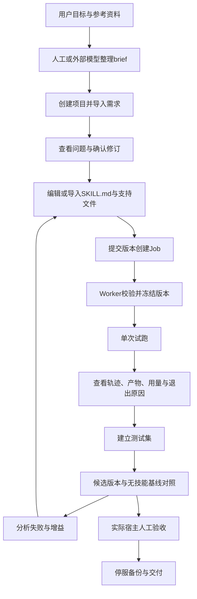
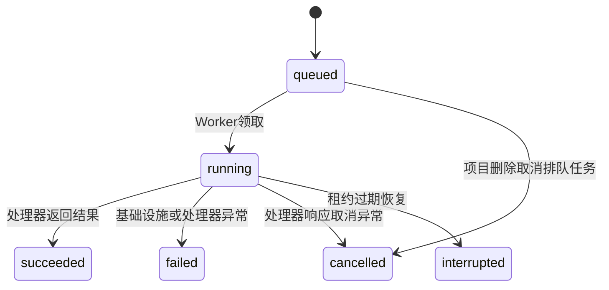
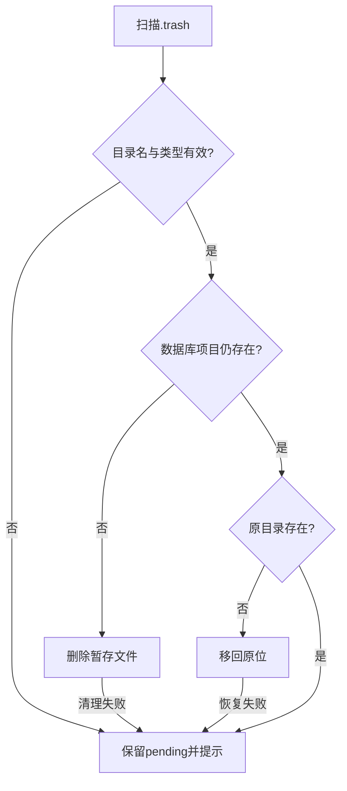

# Skill Forge v1.1 内部完整流程与实现详解

版本：1.1.0；数据库迁移：0007；整理日期：2026-10-03。

面向：项目维护者、二次开发者、交付接手人员，以及需要理解每一步实际行为的个人使用者。

本文以本交付目录内的实际源码为依据，按“输入 → 处理 → 数据/文件变化 → 输出 → 异常 → 使用细节”介绍各个流程。历史设计与源码注释存在差异时，以可执行代码为准。本文新增文档，不修改应用行为。

## 目录

1. 产品定位、术语与实现范围
2. 总体架构与端到端流程
3. 安装、配置、启动与退出
4. 项目建立与平台登记
5. 需求导入、校验、确认与修订
6. 草稿编辑与文件管理
7. 版本冻结、指纹和完整性校验
8. 队列入队、领取、心跳和终态
9. 模型适配与请求响应
10. 单次运行与工具循环
11. 文件工具与脚本执行
12. 运行记录、产物与预算
13. 测试集建立与程序断言
14. 对照评测、评分和结果解读
15. 取消、超时、宕机与恢复
16. 项目删除与文件暂存对账
17. 事件补取、SSE与前端轮询
18. 数据模型、目录和API索引
19. 备份、迁移、升级与回退
20. 创建skill的前置流程接入
21. 日常维护、排障与扩展
22. 验证记录、已知边界和文档校准

## 1. 产品定位、术语与实现范围

### 1.1 当前交付是什么

Skill Forge是个人本地技能生产与评测工作台。用户在这里整理需求、编辑技能文件、保存版本、通过模型执行技能、编写测试并比较候选与基线表现。

当前程序并不是一份安装到宿主后便能自动完成所有工作的SKILL.md。它由浏览器界面、API服务、SQLite数据库、Worker和执行器构成。将它接入“创建skill的前置skill”是可行的组合方案，但前置指令包尚未创建或安装。

当前已实现：项目管理、人工brief导入和修订、草稿文件管理、不可变版本、持久化任务、API工具循环、程序断言、候选/基线对照评测、备份恢复，以及v1.1的并发删除、独立心跳和预算证据。

当前未实现：自然语言自动提取需求、工作台内自动生成完整skill、原生宿主运行器、自动触发选择测试、盲评、自动分析和改进轮、触发优化、技能安装器、MCP服务。

### 1.2 术语

| 术语 | 实际含义 |
|---|---|
| skill | SKILL.md及为其工作提供支持的参考文件、脚本等资源 |
| 项目Project | 一个技能工作的管理容器，关联需求、版本、运行和评测 |
| brief | 对用途、触发、输入输出、工具、约束、成功标准的结构化说明 |
| BriefRevision | 某一时刻需求JSON的全量历史快照 |
| 草稿draft | 可编辑的技能文件树；实际磁盘目录名为drafts |
| SkillVersion | 冻结的技能文件树及其哈希、标签、需求关联和父版本关联 |
| Job | 队列任务，例如创建版本、执行技能、对照评测 |
| AgentRun | 一次模型工具循环的执行记录；一个评测Job可能产生多个AgentRun |
| Suite | 一组测试用例，每个用例含提示词和程序断言 |
| EvalRun | 一次候选版本与无技能基线的对照评测 |
| EvalCaseResult | 一个用例在一个组中的执行/评分记录 |
| 沙箱sandbox | 每次运行的独立工作目录，提供工具路径约束；不是操作系统隔离环境 |
| 前置skill | 在实际创建技能前整理需求与验收计划的宿主指令包，属于建议接入方案 |

### 1.3 三个不同的“成功”

- **Job succeeded**：处理器成功返回一个结果并记录。结果本身可以是预算耗尽、模型失败或取消。
- **AgentRun completed**：模型在当前执行器的规则下正常结束；仍需检查内容是否正确、预算是否超额。
- **断言通过**：结果满足所编写的检查条件；不意味着需求全部满足，也不证明description在真实宿主中会正确触发。

这三个概念必须分别显示和判断，不能只凭一个绿色状态认定整个技能合格。

## 2. 总体架构与端到端流程

### 2.1 组件职责

| 组件 | 负责什么 | 不应被误解为 |
|---|---|---|
| React/TypeScript界面 | 编辑、提交、查询、展示结果 | 完整IDE、自动生成器 |
| FastAPI API | 请求校验、项目/需求/草稿操作、任务入队、查询 | 在HTTP请求中同步跑完所有模型任务 |
| SQLite/WAL | 持久化结构化数据、队列、事件与结果 | 多用户分布式任务平台 |
| Worker | 领取任务，调用处理器，持续续租，提交结果 | 操作系统级隔离运行环境 |
| ModelProvider | 模型协议序列化和HTTP调用 | 自动选择最适合模型、自动重试所有失败 |
| ApiExecutor | 维护对话历史、工具循环、取消和预算边界 | 宿主原生skill加载器 |
| Tool Registry | 读文件、写文件、运行脚本 | 对脚本内部行为实施完整访问控制 |
| Scoring | 四类程序断言 | 全面语义质量评审 |
| Backup CLI | 数据快照导出和空目录恢复 | 技能安装包导出器 |

API和Worker通过数据库中的jobs表交接，不直接发送进程间消息。进度通过workflow_events记录；查询和SSE提供给客户端。前端生产文件由API静态托管。

### 2.2 一次完整技能工作



图中的自然语言整理、结果分析、真实宿主验收、技能安装仍需要用户或外部技能流程参与。现有工作台没有自动替用户完成这些步骤。

### 2.3 文件与数据库配合

数据库存身份、关系、状态、历史JSON和结果；磁盘存草稿、版本快照及运行目录。版本使用临时目录和重命名，删除使用暂存区和对账。SQLite事务不会把磁盘动作自动纳入同一个事务，维护者必须处理崩溃窗口。

## 3. 安装、配置、启动与退出

### 3.1 安装前提

Python要求以pyproject.toml为准，当前为3.12及以上。后端依赖由uv.lock记录，前端依赖由package-lock.json记录。Node.js用于前端构建；交付包已附带frontend/dist，直接使用当前界面时无需再次构建。

推荐在源码目录执行：

```bash
uv sync
uv run python launcher.py
```

修改前端或需要重建时：

```bash
cd frontend
npm ci
npm run typecheck
npm run build
cd ..
```

以上是项目已有命令，不表示本次已对任意目标机器完成依赖安装。不要把Windows的node_modules或Python虚拟环境直接复制到Mac使用。

### 3.2 配置读取

1. 有SKILLFORGE_CONFIG时读取该路径，否则读取项目根config.yaml。
2. 文件不存在则使用默认配置。
3. Pydantic解析server和data_dir。
4. SKILLFORGE_DATA_DIR覆盖数据目录，SKILLFORGE_PORT覆盖端口。
5. 相对数据目录锚定到配置文件所在目录，再转为绝对路径。

因此，即使启动器从另一个工作目录调用，API和Worker也应指向同一数据目录。显式CLI恢复参数的相对路径另按该命令的执行工作目录解释，不应与配置锚定混淆。

```yaml
server:
  host: 127.0.0.1
  port: 8710
data_dir: data
```

host默认回环地址。当前配置模型并没有把“只允许回环绑定”做成硬校验；修改host可能改变服务暴露范围。个人使用按默认配置启动。

### 3.3 启动执行顺序

| 顺序 | 动作 | 失败或结果 |
|---|---|---|
| 1 | bind探测host/port是否可用 | 异常转PortInUseError；权限问题也可能表现为预检失败 |
| 2 | 创建数据目录，写入再删除探针，SELECT 1 | 确认目录可写且数据库可达 |
| 3 | Alembic upgrade head | 创建/升级到0007；不能与旧服务并行迁移 |
| 4 | reconcile_project_trash | 恢复未提交删除，清理已提交删除；pending在终端提示 |
| 5 | secrets生成会话令牌 | 经SKILLFORGE_TOKEN注入子进程 |
| 6 | 拉起uvicorn API与Worker | 两个独立进程，共用数据目录 |
| 7 | 轮询/api/health | 默认等待窗口30秒，不代表Worker和模型端点均健康 |
| 8 | 打开带#token的地址，打印该地址 | 浏览器打开失败时可手动使用 |
| 9 | 等待API进程退出 | Ctrl+C走关闭流程 |

/api/health只确认API能响应和版本号，不主动检查模型连接、不验证所有数据、不确保Worker正在处理任务。

### 3.4 令牌和浏览器

启动地址示意：`http://127.0.0.1:8710/#token=会话令牌`。前端从片段读取令牌，写入localStorage并清除地址栏片段。普通API请求附带x-session-token。

URL片段不随HTTP请求发往服务器，但令牌会被打印在终端且保存在浏览器本地存储。重新启动生成新令牌，旧浏览器存储可能失效，应使用新启动地址。

Origin检查精确比较解析后的回环主机名，允许HTTP/HTTPS回环来源且不限端口；没有Origin头时不做这项判断。它不是严格的相同scheme/host/port同源比较。受保护的/api路径仍需要会话令牌。SSE允许query token；非/api路径的鉴权策略与API不同。

### 3.5 退出

Ctrl+C向API和Worker发送terminate，等待最多10秒后kill兜底。任务在进程终止时未必能完成业务收尾；租约到期后Job恢复为interrupted。正常退出不等于每一个业务结果都已成功完成。

## 4. 项目建立与平台登记

输入：name与target_platform。默认平台catpaw；已登记catpaw、codex、claude_code。

API入口：`POST /api/projects`。名称受1–200字符结构约束；平台由ProjectService检查登记表。创建ULID，写projects并提交，返回项目视图。项目列表按创建时间倒序，可带最新需求修订ID。

创建项目本身不生成SKILL.md，不建完整目录，也不请求模型。相关磁盘目录在写草稿或运行时按需出现。

**平台登记仅表示允许保存该名称。** 当前没有根据平台切换原生运行器、文件格式适配、安装目录或触发选择机制。首页创建表单只提交name，默认平台随服务端生效；需要指定平台可通过API。

项目是后续数据关联容器。name不是文件夹路径，真正目录使用project_id，避免显示名称变更或同名项目影响文件位置。

## 5. 需求导入、校验、确认与修订

### 5.1 来源与责任

现有导入路径是人工粘贴结构化JSON。用户、外部模型或将来的前置skill先准备brief；工作台解析和保存，不在此阶段调用模型。

字段来源类型：

| 类型 | 含义 | 视图 |
|---|---|---|
| user_message | 用户消息中明确提出 | 已明确 |
| user_confirmed | 经确认流程标记 | 已明确 |
| system_inferred | 推断或建议 | 系统推断 |
| attachment_text | 附件分析得到的候选内容 | 待确认 |

来源是导入者提供的结构化标记，不是服务器独立验证过的真实性或授权证据。附件中的指令必须作为内容分析，不能因其存在于文档就自动变成用户要求。

### 5.2 brief字段

| 字段 | 形状 | 作用 |
|---|---|---|
| purpose | value+source对象或null | 技能要实现的目标 |
| trigger_conditions | 带来源条目数组 | 应使用的场景 |
| non_trigger_conditions | 带来源条目数组 | 近似但不应使用的场景 |
| inputs/outputs | name、format、required、validation条目数组 | 输入与交付要求 |
| tools | 带来源条目数组 | 需要哪些工具 |
| constraints | 带来源条目数组 | 功能与操作限制 |
| success_criteria | 带来源条目数组 | 验收标准 |
| target_platform | 字符串 | 目标宿主记录 |
| evaluation_preference | 布尔值字典 | 评测偏好记录，不自动开启主观评分 |
| unresolved | 字符串数组 | 显式保留的待决事项 |

列表可使用裸数组；Schema也能接收items包装形式。输入输出、平台、偏好和unresolved不使用相同的逐字段source包装，来源追溯不是全字段完整覆盖。

### 5.3 导入请求与网页输入区别

API请求体为`{"brief": {...}}`；**网页文本框中只粘贴内部brief对象**，前端会自己包一层brief。直接把API请求体完整粘贴到网页会形成多包一层的数据。

可用示例见源码docs/examples/brief-import.json，它是API请求体。用于网页时取其中brief字段的内容。

### 5.4 两层实际校验

结构层：Pydantic解析，检查字段形状和类型。不通过时API返回422，code为validation_failed，errors包含parse_failed说明，不新增需求修订。

业务层：检查purpose非空、触发与非触发列表非空、至少一项输出、平台已登记；对触发与非触发做去首尾空白并转小写后的**字符串相等**检测。不是深度语义判断，也不是自动验证全部成功标准。

业务问题放在issues返回，**仍然允许保存draft修订**。这样可先记录不完整需求。导入成功201与issues为空是两个判断。

### 5.5 分列与修订历史

BriefDraft遍历带来源字段，把字段路径分到explicit/inferred/to_confirm。待确认还加入unresolved原有条目。这些列展示路径，不一定显示所有业务字段的完整内容。

每次导入创建新BriefRevision，保存原始JSON全量快照，status=draft，关联前一修订。列表查询可读历史ID和状态；单条查询返回完整JSON。

### 5.6 确认处理

PATCH确认接口接收`{"edits": {"purpose": "新值", "trigger_conditions[0]": "新值"}}`。路径可指向已有字段，带value/source的对象只改value。

处理步骤：读原修订 → 应用编辑 → 标记确认来源 → 再解析并做业务校验 → 新增confirmed修订 → 返回问题和分列。原draft行保留，不就地覆盖。

非附件来源字段在确认动作中转user_confirmed；attachment_text只在edits显式包含其路径时转为user_confirmed，其他附件字段保持待确认。即使值不变，也可以通过显式edits表示确认。

当前网页确认按钮发送空edits，不能据此认为附件候选已获确认。它也没有自动解决unresolved；待决条目需主动维护。**confirmed状态不强制要求issues为空或to_confirm为空**，后续版本可能关联这样的confirmed修订。

`MAX_FOLLOWUP_ROUNDS=2`出现在源码中，但没有完整的自动追问轮次引擎。不要对外承诺系统会自动追问两轮、随后自动推进。

## 6. 草稿编辑与文件管理

### 6.1 路径与格式

磁盘位置：`data_dir/projects/{project_id}/skills/drafts/`。API路径使用单数draft是资源名，与磁盘drafts不冲突。

文件路径统一用正斜杠的相对路径。例如SKILL.md、references/template.md、scripts/check.py。规范化会做Unicode NFC，并拒绝空白路径、控制字符、绝对路径、Windows盘符、反斜杠和..穿越；resolve后再检查实际目标是否在根目录内。

白名单扩展：md、txt、json、yaml、yml、toml、py、js、ts、css、html、csv、sh、ps1、ini、cfg。检查针对存在后缀的路径，不能把这段规则理解为完整文件内容安全分析。

### 6.2 写入与保存

PUT请求体为`{"content":"完整文本"}`，采用覆盖整文件方式。计算UTF-8字节数；单文件上限1,000,000字节，新文件数量上限200。创建父目录后写入字节，返回path/size。

5,000,000字节的全树限制在版本树校验时检查，不是每次草稿写入就检查。草稿仍可暂时处于无法冻结版本的状态。

前端onChange只更新编辑器和dirty状态；onBlur、点击“保存草稿”、创建版本前保存当前dirty文件会发送PUT。代码没有停顿计时器，所以不能说“输入停止几秒就必然自动保存”。保存失败应看界面提示，再确认实际草稿内容。

### 6.3 读取、删除与支持资源

GET文件接口读取UTF-8内容；DELETE移除指定草稿文件并清理空的父目录。页面删除文件有确认框；这只删除草稿，不修改已经冻结的版本。

允许保存JS/TS不意味着run_script可直接执行它们。当前脚本执行器只支持py/sh/ps1。草稿API主要处理文本，不能把它理解成通用二进制附件上传器。

建议技能正文保留必要工作步骤，长资料放references，确定性工作放scripts。参考文件通过Markdown链接明确关联。实际工具能否调用取决于当前执行器与目标宿主，不能仅在正文中写一个工具名就获得该工具。

## 7. 版本冻结、指纹和完整性校验

### 7.1 创建输入与任务

POST版本接口接收label与parent_version_id，立即入队version_create并返回202及job_id。202只表示任务入队，不表示版本已经创建或校验通过。

Worker查询该项目最新status=confirmed的需求修订，并将其ID关联到新版本；没有confirmed需求时该关联为空。因此brief并不是创建版本的硬前置条件。

### 7.2 实际校验项目

1. 遍历文件树，生成path/hash/size清单，计算总大小和数量。
2. 检查单文件、全树、数量限制和空技能。
3. 检查根SKILL.md存在；解析---包围的YAML头。
4. name与description非空；检查SKILL.md正文中的本地Markdown链接是否在文件树中。
5. 生成树哈希；同项目相同内容哈希拒绝重复冻结。
6. 复制到临时目录后重新校验和比对哈希，防止复制期间内容变化。

name非kebab-case、name超过64字符、description超过1024字符、正文超过500行属于warnings，不阻断。Markdown链接检测是正则范围内的局部检查，不是完整Markdown解析、所有脚本import检查或所有引用语义校验。

路径和扩展名保护主要发生在草稿API与版本读取路径；validate_tree并没有独立重新执行全部路径/扩展名规则。经API保存与绕过API直接向磁盘塞文件的保障范围不同。

### 7.3 快照提交

```text
草稿校验通过
  → 查询相同content_hash冲突
  → 创建新的version_id
  → copytree到 versions/{version_id}.tmp
  → 重新计算复制树哈希
  → tmp重命名为最终版本目录
  → 写SkillVersion并提交数据库
```

树哈希材料为按path排序的`path:文件sha256`行拼接，再计算整体sha256。显示标签不参与内容指纹。同样内容换一个标签仍冲突；当前没有同label唯一约束，不能宣称“同名标签一定拒绝”。

“版本不可变”是服务接口不提供修改版本操作，并在读取时检查清单哈希；没有将目录设置为操作系统只读权限。外部修改版本文件会在读取校验时被发现。

重命名与数据库提交不是同一个原子事务。若重命名之后落库失败，仍可能留下孤立版本目录；当前启动对账主要针对删除暂存区，没有全面版本孤儿清理器。

### 7.4 版本读取与使用

列表返回ID、标签、父版本、需求修订、content_hash、warnings、状态和时间；详情增加文件清单。读取文件先确认它在清单中，再计算实际内容hash并对比，之后解码UTF-8。

版本冻结成功说明结构和指定校验通过；不是脚本逻辑正确、任务有效或真实宿主触发正确的证明。新功能修改草稿再创建新版本，不直接编辑旧快照。

## 8. 队列入队、领取、心跳和终态

### 8.1 Job数据与入队

Job存type、payload_json、状态、时间、worker_id、attempt、lease、取消标记、结果和错误。enqueue提交任务后追加job_created事件。

存在idempotency_key时，同type与key可返回已有Job，不重新执行。当前版本/运行/评测的常规提交路由没有自动传用户幂等键；重复点击不应假定会合并。

### 8.2 领取

SQL在单条UPDATE中选最早queued并置running，更新worker_id、lease_expires_at、heartbeat_at、attempt和updated_at，RETURNING id。Worker.run_once无任务返回False，有任务调用对应处理器。

主循环空闲等待默认0.5秒，默认串行处理任务。当前不是按成本、优先级或用户配额分配的调度系统。

### 8.3 独立心跳

v1.1执行期间启动后台线程，以独立Session约每lease/3续租，最小间隔0.01秒。默认lease60秒，心跳约20秒。SQL只更新running且worker_id匹配的任务。

这解决模型请求阻塞120秒期间，处理器没有步进回调导致租约丢失的问题。HandlerContext.touch仍在步骤边界调用作为补充。线程异常会打印日志，持续数据库不可写仍可能失租约，不应把心跳理解为绝不会中断的保证。

### 8.4 状态机与提交



底层_finish条件更新queued/running，Worker提交另外检查归属。已终态的任务不被后到结果覆盖；结果与终态事件在同一提交中保存。SQL后expire_all避免沿用陈旧ORM状态。

Worker异常分类前rollback，避免失败事务状态下再写fail产生PendingRollbackError。unknown_handler、conflict、provider_not_configured、not_found、validation_failed和异常类名等结构化code用于排障。

## 9. 模型适配与请求响应

### 9.1 配置

实际provider_from_env读取SKILLFORGE_LLM_BASE_URL、SKILLFORGE_LLM_MODEL、SKILLFORGE_LLM_API_KEY。base_url和model必需；api_key可空，适用于不需要密钥的本地端点。当前没有实现config.yaml的llm段读取，旧注释不应作为配置依据。

适配器向`base_url去掉末尾斜杠 + /chat/completions`请求。例如base_url已含/v1时，最终路径含/v1/chat/completions。不要把完整chat/completions地址再作为base_url，否则会重复拼接。

### 9.2 请求内容

发送model、messages，按需要附tools/max_tokens/temperature。助手工具调用arguments序列化成JSON字符串；工具回复带tool_call_id。api_key存在时添加Bearer头。

当前执行器不主动指定temperature，不固定随机种子。换模型、供应商版本或响应随机性都可能影响对照结果。能力声明为tools=True、streaming=False、json_mode=True、context128000，是静态声明，不是逐模型实时探测；执行器也没有自动上下文压缩。

### 9.3 响应与错误

取choices[0]，解析message.content、tool_calls、usage和finish_reason。网络错误、HTTP错误和基础响应结构错误转ModelError。工具arguments的非法JSON尝试保留_raw供后续处理，非对象参数在执行器层阻止直接执行。

HTTP调用timeout默认120秒；没有自动网络重试或指数退避。usage缺失时按0读取，预算和费用证据随之不完整；实际账单需看提供商。

应用保存执行轨迹和内容；远程模型会收到技能正文、用户提示词和进入对话的工具输出。应用不主动把密钥写进数据库，但shell配置、脚本环境继承和远程错误内容不在“绝不泄露任何秘密”的保证范围内。

## 10. 单次运行与工具循环

### 10.1 发起运行

POST `/api/projects/{project_id}/runs`请求：

```json
{
  "prompt": "依据技能要求完成当前任务",
  "version_id": "实际候选版本ID",
  "max_tokens_total": 200000,
  "max_rounds": 40
}
```

prompt长度1–100000字符；预算可选范围100–10000000，轮次1–200。不传version_id就是无技能基线。API检查项目存在，入队agent_run返回202，版本准备与模型条件在Worker阶段进一步检查。

### 10.2 准备运行

生成run_id，创建独立sandbox。候选逐个读取快照文件并验证hash，再展开到sandbox，读取SKILL.md注入系统提示词；基线用通用任务助手提示词和空目录。准备provider之后才插入running AgentRun。

准备失败可能已有空或部分sandbox目录，但不会因provider未配置先留下一个新running AgentRun。当前没有自动清理所有准备失败产生的孤立目录。

支持文件不会全部直接注入系统提示词，模型按技能说明通过read_file读取；脚本也不会因为文件存在就自动执行。

### 10.3 循环顺序

1. 查询取消标记/任务归属丢失，必要时返回cancelled。
2. 检查轮次数和已知token累计，已耗尽就停止，不发请求。
3. 调用模型，单次max_tokens为min(4096,剩余预算)，至少1。
4. 消费usage，保存model步骤，发进度事件。
5. 再查取消，阻止模型调用期间到达的取消后继续执行工具。
6. 带工具且预算已耗尽，返回budget_exceeded，不执行本响应工具。
7. 不带工具时按finish_reason分类，返回最终内容和文件证据。
8. 带工具则将助手工具意图加入历史；逐工具前再查取消。
9. 执行工具，记录耗时/输出，追加tool消息；普通工具错误可让模型自纠。
10. 轮次递增，进入下一次模型调用。

这里的“轮次”是模型调用循环次数，不是一个响应内工具数量；一个响应可以带多个工具。

### 10.4 退出原因

| exit_reason | 判定与操作含义 |
|---|---|
| completed | 无后续工具且按规则视为正常结束；还需验收内容 |
| truncated | finish_reason=length，且未先命中预算耗尽分支；输出被截断 |
| budget_exceeded | 调用边界/轮次已耗尽，或本轮带工具而token已耗尽等 |
| tool_timeout | 脚本超过工具超时 |
| model_failed | ModelError或异常结束原因；意外执行器异常也用此收尾 |
| cancelled | 在取消检查点观察到取消/失去任务归属 |

当前无工具响应对None、stop、tool_calls结束原因有兼容处理，不能说所有completed都严格来自stop。正常stop即使超过token计划仍保留completed并显示over_limit；非stop又已耗尽时可能优先显示budget_exceeded而不是truncated。

### 10.5 正常结果与意外异常

正常返回把steps、usage、sandbox_files、budget、final_message和exit_reason完整写入AgentRun。意外异常兜底将记录收尾为finished/model_failed，但这条异常路径没有同等保存全部临时步骤、预算与文件快照；应保留磁盘目录做排查，不能宣称所有异常路径都具备完整证据。

## 11. 文件工具与脚本执行

| 工具 | 入参 | 成功输出 | 关键细节 |
|---|---|---|---|
| read_file | path | UTF-8文本，过长截断 | 缺文件、路径拒绝、读取失败返回JSON错误 |
| write_file | path/content | ok/path/bytes | 覆盖文件，单次文本上限1000000字节 |
| run_script | path/args | exit_code/stdout/stderr | 仅py/sh/ps1，超时60秒 |

工具路径先normalize_relpath再resolve/is_relative_to，避免../及指向根外的符号链接等常见越界路径。文本输出进入对话前截到约20000字符，带截断说明。

Python脚本使用sys.executable，bash按环境寻找，PowerShell使用pwsh。传绝对脚本路径，cwd为sandbox，参数以列表交给subprocess，无shell命令拼接。py运行环境就是Worker环境，不为每个skill自动创建专属依赖环境。

脚本非0退出码作为工具结果回填模型，不直接等于整个AgentRun失败。模型可能分析stderr后纠正脚本再运行。

stdout/stderr使用capture_output收集，随后各切片约1000000个解码字符，再切片工具JSON。常量名称虽为BYTES，实际切片对象是字符串；不是实时限制子进程输出字节或内存占用。脚本可能产生二进制文件，最终清单可记录，但read_file/file_contains不能用作二进制内容解析器。

普通文件工具路径约束无法阻止脚本内部访问其他目录、网络或继承环境变量；超时处理也没有跨平台完整进程树回收机制。个人可信脚本运行与不可信代码隔离是不同需求。

## 12. 运行记录、产物与预算

### 12.1 记录包含什么

GET运行详情返回id、project_id、version_id、prompt、status、exit_reason、final_message、steps、usage、error_detail、sandbox_files、budget、sandbox_dir、created_at和finished_at。

steps按model/tool记录，含内容、工具名、参数、输出、耗时和模型用量。数据库通常在运行完成时存完整steps_json；运行中步骤事件只是摘要，不是每一个完整记录实时持久化。

sandbox_files分为files清单和text_contents。清单含相对路径、大小、是否文本；UTF-8可读文件另外保存内容。运行目录包含预先展开的SKILL.md和支持文件，**清单并非只列本轮新生成文件**；验收应使用输出专用路径，避免把原本就有的文件当成果。

### 12.2 token预算

默认每个AgentRun预算200000，40轮；累计包括prompt_tokens和completion_tokens，通常多轮会重复计算历史输入。

```json
{
  "limit_tokens": 100,
  "used_tokens": 115,
  "over_limit": true,
  "overrun_tokens": 15
}
```

单次max_tokens只约束输出，不能限制输入消耗。某次请求可能让累计超过总预算；v1.1阻止在此之后执行新增工具或发下一轮请求，但不会撤销已经发生的调用费用。正常输出完成和预算超额分别记录。

旧记录迁移后budget={}，前端不伪造历史上限。提供商不返回usage时，记录也无法据此保证实际支出。

### 12.3 查看结果的顺序

先看Job有没有结果；再看AgentRun退出原因；再看文件/最终文本是否满足要求；再看预算；最后看工具错误和步骤。completed但文件缺失可能是技能说明或模型执行问题，不应通过修改状态显示掩盖。

## 13. 测试集建立与程序断言

### 13.1 输入与校验

Suite包含name和cases。name1–200字符；cases1–100项；case.id1–64字符，仅字母数字下划线连字符；prompt1–100000字符；name可选，assertions可为空。

创建检查用例ID重复、断言类型白名单及所需字段，错误422返回逐条errors。正常201写suites，cases_json存用例数组。suite列表不含完整cases；详情GET `/api/suites/{suite_id}`读取。

空assertions合法，但完成执行后得到0个断言，不能解释为质量通过率100%。当前没有专门suite编辑/删除API，修改套件可新建一份。

### 13.2 四种断言

| type | 必需字段 | 检查对象 | 不能证明什么 |
|---|---|---|---|
| file_exists | path | 全量文件清单，包括二进制 | 文件内容正确、文件是本轮新产物 |
| file_contains | path/contains | UTF-8文本内容，精确子串 | 语义正确、数据真实 |
| text_contains | contains | final_message精确子串 | 整份输出质量 |
| exit_reason_is | value | 执行退出原因 | 业务任务满足所有标准 |

套件示例：

```json
{
  "name": "周报输出验收",
  "cases": [
    {
      "id": "weekly_01",
      "name": "标准素材",
      "prompt": "本周完成登录接口与回归测试；发布因审核延期。下周处理审核意见。请写到out/weekly-report.md，并包含本周进展、问题、下周计划。",
      "assertions": [
        {"type": "file_exists", "path": "out/weekly-report.md"},
        {"type": "file_contains", "path": "out/weekly-report.md", "contains": "本周进展"},
        {"type": "file_contains", "path": "out/weekly-report.md", "contains": "下周计划"},
        {"type": "exit_reason_is", "value": "completed"}
      ]
    }
  ]
}
```

这是POST suites的完整请求体。网页测试集用例框只粘cases数组，name填单独字段。它是验收输入示例，不是已运行的模型成绩。

## 14. 对照评测、评分和结果解读

### 14.1 发起与运行规模

输入suite_id、version_id，可覆盖max_tokens_total/max_rounds。API检查项目和套件归属，入队eval_run返回job_id。Worker新建EvalRun，依次运行每个case的candidate、baseline。

N个用例通常产生2N次AgentRun，每个可能包含多轮模型调用。**预算参数应用到每一个用例×组的AgentRun，不是整次EvalRun的总额。** 10个用例、每次200000token意味着可有20个独立预算，不能把200000当整套评测费用上限。若需要全套总预算，应新增专门控制。

### 14.2 候选与基线

候选：指定版本文件展开，SKILL.md注入系统提示词。基线：通用系统提示词，初始目录为空。两组使用相同case.prompt及同一环境配置的provider。

两组差别不仅是文字说明，也包含初始支持文件和脚本。因此观察到提升是“整份技能包在当前执行器下的表现”，不是仅description或仅正文的单独效果。当前固定candidate先、baseline后，单次顺序比较不消除所有随机性或供应商波动。

### 14.3 单例状态

执行异常或exit_reason非completed → exec_failed/not_scored；completed → 调用score_assertions；正常评分 → scored；评分步骤异常 → score_failed。断言passed=false仍是scored，表示正常完成检查但结果不达标。

评分函数还支持旧版扁平沙箱内容映射。单条非法字段/未知类型通常记该断言failed和detail；断言列表不是数组或元素不是对象抛ScoringError。新套件API已前置拦截多数结构问题，但历史或绕过API的数据仍可能在评分阶段暴露问题。

评测器仅对completed评分，因此设置exit_reason_is=budget_exceeded不会让预算耗尽用例进入正常评分路径。要专测失败退出，需要扩展评测策略或直接在执行层测试。

### 14.4 汇总

每组独立汇总cases、executed、exec_failed、skipped、scored、score_failed、passed_total、assertions_total。passed_total/assertions_total来自该组scored记录，不含未评分用例。

例如候选有部分用例执行失败，剩余已评分断言全通过，显示的断言通过率仍可能很高。必须同时看执行失败/跳过/评分失败计数，否则分母会隐藏失败。

### 14.5 取消与异常

用例边界看到取消后，为其余case×group新增skipped/not_scored行；已完成结果保留。当前正在运行的AgentRun可能返回cancelled，该行视为exec_failed。评测处理器最后仍可把EvalRun标finished并返回，外层Job成为succeeded；不能仅凭Job状态判断评测有没有被中途取消。

provider未配置或VersionNotFound通常作为基础设施失败收尾EvalRun并上抛Job failed。某些快照读取错误、其他单例异常按单例exec_failed处理；不能把所有“版本问题”都归为同一个Job级错误。

### 14.6 结果应如何支持改进

将每项用户需求映射到验收用例；查看失败例的运行轨迹，判断需求遗漏、指令含糊、工具不可用、输出截断还是断言写错。修改草稿，冻新版本，复跑相同suite并保留独立验证例。

当前界面比较候选与无技能基线，不是任意两个版本同次直接对照。不同候选版本需分别发起评测再人工比较。质量、事实忠实性、真实宿主触发行为仍需要人工/宿主验证。

## 15. 取消、超时、宕机与恢复

### 15.1 取消接口

POST `/api/jobs/{job_id}/cancel`设置cancel_requested并返回Job视图。不存在404；已经终态仍可能更新取消标记，但不会通过_finish改变既有终态。

取消不是立即中断：模型HTTP请求和已经运行的脚本可能继续到返回或超时。在模型返回后与每个新工具执行前检查取消，避免再开始新工具。version_create处理器没有同等细粒度取消检查，已领取的短版本任务可能仍完成。

### 15.2 租约过期

recover_stale将lease_expires_at早于当前时间的running置interrupted，记录lease_expired，并追加恢复事件。Worker启动先扫描，常驻主循环按recover_interval再次扫描。

它不自动重试业务，也不把旧Job重新排队。用户决定是否提交新任务；新运行有新ID和目录。attempt增长不代表已实现自动重试策略。

租约恢复针对jobs，不保证同时将所有AgentRun/EvalRun业务行的running状态改掉。进程被强杀时，应结合Job终态和业务行判断，不能只看业务行是否finished。

### 15.3 迟到Worker结果

Worker终态提交检查running/worker归属；陈旧缓存不能覆盖已interrupted任务。HandlerContext检查也把终态或归属变化当作取消条件，阻止后续新工具。

这仍不能撤回一个已经执行的脚本副作用；如果扩展远程写操作，必须另设计幂等、授权和结果对账。

## 16. 项目删除与文件暂存对账

### 16.1 删除条件

DELETE项目开始BEGIN IMMEDIATE，阻止同库其他写事务在删除关键区间领取任务。扫描关联Job的payload.project_id；任一running时回滚并返回409/project_busy，提示取消并等待结束。

项目不存在返回404。正常删除204；queued任务被标cancelled，终态Job和既有事件不作为项目子数据全部删掉，仍可能保留历史队列记录。

### 16.2 删除步骤

1. 确认项目和运行任务条件。
2. 将项目目录重命名到`.trash/{project_id}.{new_ulid}`，原位置不再提供活动目录。
3. queued任务取消及事件在同一数据库事务内添加。
4. 删除eval_case_results、eval_runs、agent_runs、suites。
5. 解除skill_versions对brief/parent引用后删除版本，再删需求和项目。
6. 一次commit。
7. commit后清理暂存目录；失败保留并返回X-Cleanup-Pending:true。

commit前异常先rollback，再尝试把暂存目录移回原位置。恢复本身权限失败时可能还需启动对账，不能说任何磁盘故障都立即恢复。

### 16.3 启动对账



对账返回restored/removed/pending计数。只自动处理符合ULID.ULID格式的正常目录；符号链接和异常名称保留。原目录冲突时不覆盖文件。

该方案解决数据库与文件系统删除的主要崩溃窗口，但没有提供用户可随意恢复已成功删除项目的回收站UI，也不是安全擦除。删除前需要恢复能力时先做停服备份。

## 17. 事件补取、SSE与前端轮询

workflow_events以递增event_id记录创建、进度、成功、失败、取消。`GET /api/events?after_id=...`补取，limit上限1000；SSE支持Last-Event-ID。

SSE连接先发connected注释，无新事件发ping，约0.5秒一次循环，默认3600秒最长连接。令牌可通过query传入，可能出现在访问URL/访问日志，不应把启动URL片段的“不随请求发送”泛化到SSE令牌。

SSE是步骤进度，不是模型逐token文本流。当前模型调用streaming=False。

现有版本/运行/评测界面主要查询Job并轮询终态，不依赖SSE完成所有交互。版本创建约每300ms查询，最多约600次，达到等待上限只是前端停止等，不会自动取消后台Job。

用户刷新浏览器或关闭页面不等于后台任务取消。前端任务轮询暂时失败也不等于Job failed，应重新查询任务与业务结果。

## 18. 数据模型、目录和API索引

### 18.1 数据关联

| 表 | 所属/关系 | 存储内容 |
|---|---|---|
| app_meta | 应用 | 元数据 |
| projects | 顶层容器 | 名称、目标平台、创建时间 |
| brief_revisions | project、parent revision | 全量brief JSON和draft/confirmed |
| skill_versions | project、brief、parent version | 标签、树哈希、文件清单、warnings、状态 |
| jobs | type/payload，可含project_id | 队列、租约、取消、结果、错误 |
| workflow_events | 可关联job | 事件与进度JSON |
| agent_runs | project、可关联version | 提示、状态、轨迹、用量、产物、budget |
| suites | project | name与cases JSON |
| eval_runs | project、suite、version | 评测状态和时间 |
| eval_case_results | eval_run、可关联agent_run | 用例组、执行与评分状态、断言成绩 |

0007新增agent_runs.budget_json，非空默认{}。ID采用ULID；排序通常还依赖明确的created_at。JSON字段不是通用权限或校验系统。

### 18.2 运行数据目录

```text
data_dir/
  app.db
  app.db-wal / app.db-shm       # SQLite运行中伴生文件
  projects/
    {project_id}/
      skills/
        drafts/
          SKILL.md
          references/...
          scripts/...
        versions/
          {version_id}/...
          {version_id}.tmp/... # 中间态，正常成功后重命名
      runs/
        {run_id}/sandbox/...
  .trash/
    {project_id}.{ulid}/...     # 删除暂存，启动恢复/清理
```

源码、数据库、技能版本、运行产物和数据备份是不同层次。源码ZIP更新不能覆盖个人数据；数据备份ZIP也不是源码发布ZIP。

### 18.3 API完整工作入口

以下全部为实际路由，`{pid}`指project_id。除health外/api请求需要令牌；SSE可query传令牌。

| 方法 | 路径 | 用途 |
|---|---|---|
| GET | /api/health | 健康与版本 |
| GET | /api/me | 令牌连通性 |
| POST/GET | /api/projects | 创建/列出项目 |
| GET/DELETE | /api/projects/{pid} | 项目详情/删除 |
| POST/GET | /api/projects/{pid}/briefs | 导入/修订列表 |
| GET/PATCH | /api/projects/{pid}/briefs/{revision_id} | 完整修订/确认编辑 |
| GET | /api/projects/{pid}/skills/draft | 草稿文件树 |
| GET/PUT/DELETE | /api/projects/{pid}/skills/draft/files/{file_path} | 草稿文件操作 |
| POST/GET | /api/projects/{pid}/skills/versions | 异步创建/列出版本 |
| GET | /api/projects/{pid}/skills/versions/{version_id} | 版本详情 |
| GET | /api/projects/{pid}/skills/versions/{version_id}/files/{file_path} | 校验后读取版本文件 |
| GET | /api/jobs/{job_id} | 任务状态与结果 |
| POST | /api/jobs/{job_id}/cancel | 请求取消 |
| GET | /api/events | 增量事件 |
| GET | /api/events/stream | SSE |
| POST/GET | /api/projects/{pid}/runs | 提交运行/历史 |
| GET | /api/runs/{run_id} | 运行详情 |
| POST/GET | /api/projects/{pid}/suites | 新建/列出测试集 |
| GET | /api/suites/{suite_id} | 测试集详情 |
| POST/GET | /api/projects/{pid}/eval-runs | 提交/列出评测 |
| GET | /api/eval-runs/{eval_run_id} | 评测详情与汇总 |

异步接口返回job_id，业务ID通常从job.result中读取；不同ID不要混用。运行历史上限100，suite列表上限100，eval历史上限50，当前没有完整分页接口。

### 18.4 错误响应

鉴权/Origin中间件使用`{"error":{"code":...}}`；路由HTTPException多用`{"detail":{"code":...,"errors":[...]}}`；Pydantic请求结构错误也可能是detail数组。客户端不能假设所有错误都是同一种结构。

典型状态：401令牌错误、403来源拒绝、404不存在、409项目运行中、422结构/文件/套件校验。异步版本冲突在Job.error.code=conflict记录，不是原提交POST直接返回HTTP409。

## 19. 备份、迁移、升级与回退

### 19.1 导出

先停止API和Worker，将输出放在data_dir之外：

```bash
uv run python -m app.backup create --out ../skillforge-backup.zip
uv run python -m app.backup info ../skillforge-backup.zip
```

create用SQLite backup API复制一致数据库快照，避免直接复制WAL运行库；然后归档manifest、app.db及数据目录其他文件，跳过数据库伴生文件。磁盘文件没有同时建立跨介质快照，停服是得到整体一致备份的重要前提。

manifest记录tool、manifest_version、created_at、schema_version、db_file。file_count是create结束后返回给CLI的统计，不应假定包内manifest也包含它。当前没有逐文件签名或sha256清单来验证数据备份来源。

若data_dir有.trash残留也可能进入归档；解压恢复并启动后按数据库对账处理。

### 19.2 恢复

```bash
uv run python -m app.backup restore ../skillforge-backup.zip --data-dir data-restored
```

目标必须不存在或为空。检查ZIP、manifest标识/版本、成员路径，解压临时目录，确认数据库存在并通过quick_check，之后移动到目标。目录非空时拒绝覆盖。

恢复并非数据库与全部文件的原子切换；移动中磁盘失败可能产生部分目标内容。失败后保留备份，检查目标再决定重新恢复到另一个空目录。

### 19.3 升级

停服 → 数据备份 → 解压新源码到新目录 → uv sync → 设置原数据目录或恢复备份 → launcher迁移 → 暂存对账 → 启动 → 检查项目、版本和历史记录。

不能同时让旧API/Worker连接正在迁移的数据库。恢复旧schema可执行uv run alembic upgrade head或使用launcher。回退优先恢复升级前完整备份和对应源码，不只降级表结构或替换几份Python文件。

Mac/Windows迁移时重装各自平台依赖；脚本所需bash/pwsh/系统库、文件路径和外部命令需要目标机实际验证。曾经的本机测试通过不等于已做Windows+Mac完整兼容认证。

### 19.4 源码包校验与数据备份区别

本交付源码有SOURCE-MANIFEST.json和源码ZIP.sha256；交付文件夹有总校验清单。这些用于检查交付文件复制完整性。它们不自动给运行时数据备份提供防篡改保证，也不替代实际宿主测试。

## 20. 创建skill的前置流程接入

### 20.1 推荐分工

前置skill整理用途、触发边界、工具条件、输入输出、约束和验收计划；skill-creator或普通创建流程生成/修改技能；工作台保存版本和运行评测；用户在真实宿主做最终验收。

前置步骤不能擅自缩减用户功能。每个功能对应技能步骤/资源/用例；已完整的需求快速交接，不重复追问；必要条件未知时保留明确缺口。

### 20.2 文件交接

建议交付brief.md、需要导入时的brief.json、test-plan.md、handoff.md。小任务可合并，复杂任务拆分。文件内容需要记录用户明确要求、推断、待确认、目标平台、工具实际可用性和授权范围。

现有程序不自动读这四个文件触发完整创建流程。用户导入JSON并将下游生成的文件写入草稿。当前适用的是显式、可检查的交接方式。

### 20.3 可选API接入

新增真实客户端后可自动创建项目、导入需求、写草稿、冻结版本、提交suite和eval并轮询Job。客户端应使用现有真实接口/Schema，处理令牌、异步ID和异常；服务未启动时仍能提供文件交接。

当前没有现成的完整客户端、MCP或安装接口。本文描述扩展路线，不把普通HTTP接口称为已经接入的宿主工具。

### 20.4 验收标准

前置skill价值看需求遗漏、补充次数、首次可运行率、验收通过率及成本，不能只看产出文档更长。触发测试必须在真实宿主进行，包含应触发、不应触发、需求完整不重复问、附件指令不越权、工具缺失和保留全部功能的样例。

skill description只是加载线索，不是全局强制执行器；需要稳定个人流程时可显式调用前置skill。具体设计见[前置skill适配评估](../02-最终说明与评估/前置skill适配评估.md)。

## 21. 日常维护、排障与扩展

### 21.1 常见故障

| 症状 | 优先核对 | 处理方向 |
|---|---|---|
| 401 | 新会话令牌、浏览器旧存储 | 用当前launcher带token地址 |
| 403 | Origin是否精确回环 | 按本地入口访问；检查调用环境 |
| API正常但Job长期queued | Worker进程、数据库路径是否一致 | 查Worker日志与配置 |
| Job interrupted | lease_expired、数据库繁忙、进程被杀 | 评估副作用后提交新任务 |
| Job succeeded但没有预期成果 | run.exit_reason、轨迹、产物 | 按执行与业务层分别排查 |
| provider_not_configured | BASE_URL和MODEL | 设置后重启相关进程 |
| 401/429等模型HTTP错误 | endpoint、供应商凭据/额度 | 查模型错误细节与提供商 |
| validation_failed | 文件路径、大小、SKILL.md、链接 | 修改草稿再冻结 |
| conflict | existing_version_id/content_hash | 使用既有版本或改动内容 |
| project_busy | 项目running任务 | 取消或等待后再删 |
| 删除后pending | .trash、原目录冲突/权限 | 停服检查，保留证据再对账 |
| score_failed | assertions结构和评分错误 | 修复测试数据，不误判技能质量 |
| exec_failed | AgentRun退出原因 | 排查模型/工具/预算 |
| 两组分数都高或都低 | 测试难度、断言区分度、提示内容 | 补充有区分度与独立验证用例 |

### 21.2 安全重试删除对账

停止API和Worker后：

```bash
uv run python -c 'from app.core.config import load_config; from app.services.projects import reconcile_project_trash; print(reconcile_project_trash(load_config()))'
```

命令会根据数据库项目存在性恢复或清理，不是无条件删除.trash。有原目录冲突时先人工比较，不能直接覆盖。

### 21.3 修改模块时应同时考虑

| 扩展 | 相关模块 | 必须同步校验 |
|---|---|---|
| 新Job类型 | handlers注册、API入队 | 取消、归属、失败分类、长任务心跳 |
| 新模型协议 | llm/base、adapter、factory | 消息、工具参数、usage、结束原因、错误 |
| 新工具 | TOOL_SCHEMAS、TOOLS | 路径、入参、副作用、超时、错误回填 |
| 新断言 | scoring、evals校验、前端类型 | 结构非法与不达标分层 |
| 新数据字段 | models、migration、API、前端 | 历史默认、往返迁移、JSON兼容 |
| 整套评测总预算 | eval处理器与预算策略 | case/group之间累计和停止后的结果记录 |
| 自动生成闭环 | 需求提取、生成处理器、文件验证、评测 | 来源、完整功能映射、失败保留、人工决策 |
| 原生宿主适配 | 新运行器与目标环境 | description触发、资源加载、权限、安装路径 |

扩展不应绕过现有不可覆盖终态、版本完整性、执行与评分分层和数据备份流程。

## 22. 验证记录、已知边界和文档校准

### 22.1 当前已做验证

v1.1修复阶段的后端完整套件为134 passed、1 skipped；跳过的是已有None-Origin占位。TypeScript检查、Vite生产构建和8项路由测试通过。9项新增回归先失败后通过，并做过独立生产代码复核。

本次文档根据源码重新核对；没有因编写文档再调用真实模型或宣称新增软件功能。真实模型兼容性、干净环境uv sync安装、Windows完整运行、完整浏览器交互和宿主触发仍需目标环境验证。

### 22.2 必须保留的事实边界

- 个人本地工作台不等于全自动skill创建器；前置skill仍为设计。
- 平台登记不等于原生运行/安装适配。
- 目录路径约束不等于脚本、进程、网络和环境隔离。
- completed不等于内容正确或预算合规。
- scored且断言全过不等于没有执行失败，更不等于真实宿主触发正确。
- 输入usage和单次超额使token预算不是账单硬上限。
- 每例预算不是整个评测总预算。
- Job终态保护不撤销已执行的外部副作用。
- 文件系统与数据库依然存在跨介质提交窗口。
- 来源标记不是独立授权证明；confirmed不强制解决所有issues。
- 运行时数据备份无逐文件签名/哈希验真。

### 22.3 相对旧说明校准的细节

| 旧说法容易造成的理解 | 本文核对后的实际行为 |
|---|---|
| 草稿目录draft | 实际磁盘目录drafts |
| 停顿即自动保存 | 界面失焦、手动保存或创建版本前保存；没有停顿定时器 |
| 模型三个环境变量都必需 | BASE_URL、MODEL必需；API_KEY可空 |
| config.yaml有llm读取 | 当前工厂只读取模型环境变量 |
| 两轮追问自动推进 | 常量存在，完整自动追问引擎未实现 |
| confirmed代表无待确认项 | 可以仍有issues、附件候选及unresolved |
| 版本校验就是哈希四重检查 | 主要为文件限制、SKILL结构、链接、指纹与复制复验 |
| 同label必然冲突 | 当前主要冲突条件为同项目content_hash |
| 快照目录操作系统只读 | 接口不可写+读取hash检查，未设OS只读权限 |
| 所有错误都是detail | 中间件error与路由detail并存 |
| SSE不会让令牌出现在URL | SSE query可带token，可能被访问日志记录 |
| manifest一定含file_count | CLI返回统计含file_count；包内manifest不一定有 |
| 83项测试 | v1.1完整套件135项，134通过1跳过 |

这些差异不代表删减功能，而是确保维护者和外部读者理解真正的使用条件与能力范围。

### 22.4 源码定位

从本文件相对链接可直接定位交付源码：

- [launcher.py](../01-源码与发布包/skill-forge-v1.1-source/launcher.py)：启动、迁移、删除对账、进程与令牌。
- [config.py](../01-源码与发布包/skill-forge-v1.1-source/app/core/config.py)与[db.py](../01-源码与发布包/skill-forge-v1.1-source/app/core/db.py)：配置与SQLite。
- [projects.py服务](../01-源码与发布包/skill-forge-v1.1-source/app/services/projects.py)与[brief_schema.py](../01-源码与发布包/skill-forge-v1.1-source/app/services/brief_schema.py)：需求与删除。
- [skill_files.py](../01-源码与发布包/skill-forge-v1.1-source/app/services/skill_files.py)：文件校验与版本。
- [queue.py](../01-源码与发布包/skill-forge-v1.1-source/app/services/queue.py)与[worker.py](../01-源码与发布包/skill-forge-v1.1-source/app/workers/worker.py)：任务与租约。
- [openai_compat.py](../01-源码与发布包/skill-forge-v1.1-source/app/llm/openai_compat.py)：模型协议。
- [api_executor.py](../01-源码与发布包/skill-forge-v1.1-source/app/executors/api_executor.py)与[registry.py](../01-源码与发布包/skill-forge-v1.1-source/app/tools/registry.py)：工具循环与子进程。
- [agent_run.py](../01-源码与发布包/skill-forge-v1.1-source/app/workers/handlers/agent_run.py)与[eval_run.py](../01-源码与发布包/skill-forge-v1.1-source/app/workers/handlers/eval_run.py)：运行与对照评测。
- [scoring.py](../01-源码与发布包/skill-forge-v1.1-source/app/services/scoring.py)与[backup.py服务](../01-源码与发布包/skill-forge-v1.1-source/app/services/backup.py)：断言与数据归档。
- [api目录](../01-源码与发布包/skill-forge-v1.1-source/app/api)：接口契约。
- [skill-pane.tsx](../01-源码与发布包/skill-forge-v1.1-source/frontend/src/skill-pane.tsx)：实际编辑与保存行为。
- [v1.1验证报告](../02-最终说明与评估/skill-forge-v1.1修改与验证报告.md)：修复与验证记录。
